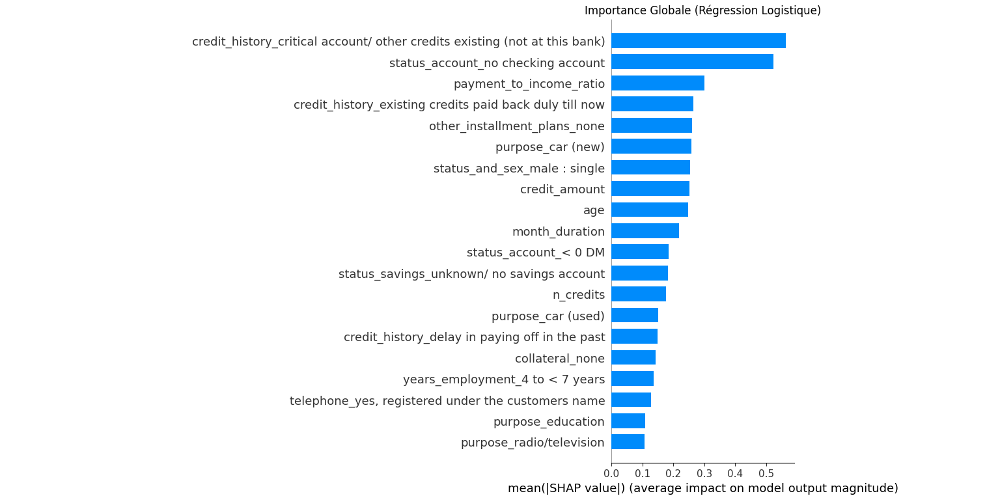
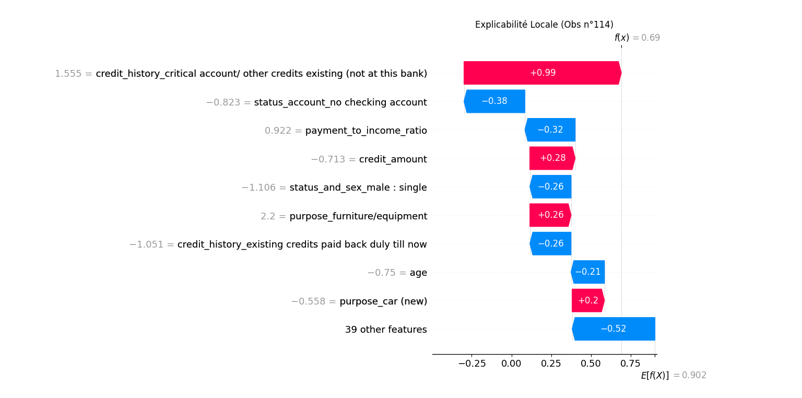

# Explainable Credit Classification

**Compare tabular classifiers and explain their predictions with SHAP and interpretable models.**

This project explores the German Credit dataset through logistic regression,
a decision tree, an MLP, XGBoost and a Bayesian network. It combines global feature
importance, explanations for individual predictions and surrogate models.

**Python · scikit-learn · SHAP · XGBoost · pgmpy · pandas**

## What it explores

| Method | Interpretation approach |
|---|---|
| Logistic regression | SHAP linear explanations |
| Decision tree | Direct visualization of learned decision rules |
| MLP | Kernel SHAP and tree/logistic surrogate models |
| XGBoost | Tree SHAP |
| Bayesian network | Learned dependencies, conditional probabilities and inference |





The original figures are preserved, including their French labels. Additional
examples: [MLP global explanation](docs/images/mlp-global-shap.png),
[MLP local explanation](docs/images/mlp-local-shap.png),
[Bayesian network](docs/images/bayesian-network.png).

## Run an experiment

Use Python 3.11 or 3.12. From the repository root, create and activate a virtual
environment, then install:

```bash
python -m pip install -r requirements.txt
```

The small CSV used by the project is included. Choose one experiment:

```bash
python -m src.LogisticReg_impl.LogisticReg_impl
python -m src.DecisionTree_impl.DecisionTree_impl
python -m src.MLP_impl.MLP_impl
python -m src.XGBoost_impl.XGBoost_impl
python -m src.BAYESIAN_impl.BAYESIAN_impl
```

These commands fit a model and open matplotlib figures. MLP Kernel SHAP can be
slow. Bayesian network figures are written to ignored `outputs/`.
The selected figures in `docs/images/` are historical outputs and are not overwritten.

## Data and evaluation

The local CSV has 1,000 rows and 20 predictors. The target is encoded as
**1 = good credit, 0 = bad credit**. The scripts use an 80/20 split with seed 42.
Standardization for logistic regression and the MLP is fitted on training data.

The repository preserves the original experimental setup. One-hot category
discovery and numeric imputation occur before the split in the shared loader;
future benchmarking should fit all preprocessing on training data only and use
cross-validation. The Bayesian script's historical AUC uses hard predictions and
excludes failed inference cases, so it should not be compared directly to the
probability-based AUC of the other models.

No verified machine-readable comparison log accompanied these figures. This README
therefore does not present the handwritten model scores or subjective
"explainability ratings" as a reproducible benchmark. SHAP describes model behavior;
it does not establish causal effects or model fairness.

## Structure

- `src/`: model-specific experiments and shared data preparation.
- `data/`: the small input CSV and its source reference.
- `docs/images/`: selected original explanations.
- `outputs/`: generated files, excluded from Git.

## References

- [Statlog (German Credit Data), UCI](https://archive.ics.uci.edu/dataset/144/statlog-german-credit-data).
- [SHAP](https://github.com/shap/shap).
- [pgmpy](https://github.com/pgmpy/pgmpy).

See [data provenance](data/README.md).
